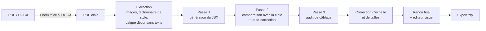

<div align="center">

# CV Smart · Design-to-Code

**Transforme le design d'un CV (PDF ou DOCX) en composant React prêt à brancher, ou en template Jinja prêt à remplir.**


</div>

---

Chaque cabinet de conseil a son propre gabarit de dossier de compétences. Reproduire ce gabarit à la main en React, avec
la pagination, les marges, les puces, les images de fond, prend des heures. **CV Smart Design-to-Code** automatise ce travail :
on dépose le gabarit, un modèle de langage multimodal le reconstruit, se compare à la cible pixel par pixel, puis s'auto-corrige.

Le résultat est un composant `<Nom>TemplateHtml({ cvData, assets })` qui réutilise le moteur de pagination du produit
(`PaginatedEntryPages`, `splitEntryIntoFragments`) et un export zip au format attendu par l'application cible.

## Fonctionnalités

- **PDF → React** : extraction du PDF, génération du JSX en plusieurs passes, auto-correction visuelle, correction d'échelle et de tailles.
- **DOCX → Jinja** : un template Word est balisé pour `docxtpl` (variables, boucles, conditions) à partir d'un CV exemple, avec la configuration et les prompts d'extraction associés.
- **Conversion DOCX → PDF automatique** : un `.docx` déposé dans l'interface est converti en PDF (LibreOffice) avant d'entrer dans la pipeline.
- **Pagination réelle** : le composant généré passe par le même moteur de pagination que la production, il déborde donc proprement sur plusieurs pages.
- **Éditeur visuel** : déplacer, redimensionner, retoucher les images et les textes directement sur le rendu.
- **Édition en langage naturel** : un panneau de chat applique une modification précise au JSX sans régénérer le template.
- **Suivi des coûts** : tokens et coût estimé de chaque passe, avec le cache de prompt pris en compte.
- **Annulation** : un run peut être arrêté à tout moment, y compris en plein appel au modèle.
- **Export** : archive zip avec le composant, le CSS Tailwind compilé et scopé, et les images.

## Comment ça marche



Le modèle ne devine rien « à l'œil » : il reçoit l'image cible, un **dictionnaire de style** extrait du PDF (position,
taille et couleur exactes de chaque texte), un **calque décor** sans texte pour découper les éléments graphiques, et une
**référence de template** déjà intégrée en production.

## Installation

### Prérequis

| Outil | Rôle |
| --- | --- |
| Python 3.12+ | backend FastAPI et scripts d'extraction |
| Node.js 20+ | frontend Vite, esbuild et Tailwind (compilation des templates) |
| Poppler (`pdftoppm`, `pdftohtml`, `pdfinfo`) | rasterisation et extraction du PDF |
| LibreOffice (`soffice`) | conversion DOCX → PDF et prévisualisation Jinja |
| Chromium via Playwright | captures du rendu |

Sur macOS :

```bash
brew install poppler
brew install --cask libreoffice
```

### Dépendances

```bash
# Backend
python3 -m venv venv
source venv/bin/activate
pip install fastapi "uvicorn[standard]" python-multipart python-dotenv \
            openai anthropic docxtpl python-docx pikepdf pillow numpy lxml playwright
playwright install chromium

# Outils Node de la pipeline (esbuild, tailwind, pixelmatch)
cd pipeline && npm install && cd ..

# Frontend
cd frontend && npm install && cd ..
```

## Configuration

Copier `pipeline/.env.example` vers `backend/.env` et renseigner la clé du fournisseur :

```env
MOONSHOT_API_KEY=...        # Kimi K3.1 Pro (modèle par défaut)
ANTHROPIC_API_KEY=...       # uniquement si MODEL pointe sur un modèle Claude
```

Le modèle se change dans une seule constante, `MODEL`, de `backend/cvsmart/pipeline/services/model_client_service.py`.
La table `PRICING` du même fichier sert à estimer le coût de chaque passe.

Variable optionnelle : `SOFFICE_PATH`, si `soffice` n'est pas trouvé automatiquement.

## Lancer le projet

```bash
# Terminal 1 : backend (port 8100)
cd backend
../venv/bin/uvicorn cvsmart.main:app --port 8100

# Terminal 2 : frontend (port 5173, proxy vers le backend)
cd frontend
npm run dev
```

Ouvrir <http://localhost:5173>, déposer un PDF ou un DOCX, choisir l'effort de raisonnement, lancer la génération.

## Architecture

```text
.
├── backend/cvsmart/          API FastAPI, une app par fonctionnalité
│   ├── runs/                 création, suivi, annulation des runs PDF → React
│   ├── jinja/                run DOCX → Jinja
│   ├── editor/               rendu, édition d'images, édition par chat
│   ├── download/             export zip
│   ├── rendering/            rendu HTML/PNG des pages (Playwright)
│   ├── jsx/                  données d'exemple, format DB, retouches du JSX
│   ├── pipeline/             orchestration des passes et client modèle
│   └── shared/               chemins, erreurs communes
├── frontend/                 React 19 + Vite, éditeur visuel et suivi des runs
├── pipeline/
│   ├── prompts/              prompts de chaque passe
│   ├── src/extraction/       scripts Python d'extraction PDF / DOCX
│   ├── src/rendering/        bundle esbuild et réduction d'images pour la vision
│   ├── src/tailwind/         configuration Tailwind des previews et de l'export
│   └── src/public/           overlay de l'éditeur visuel
├── templates copy/           moteur de pagination de référence et template d'exemple
└── exemple-jinja/            exemples de prompts et de configuration Jinja
```

Chaque app du backend suit la même organisation : `controllers`, `services`, `urls`, avec un fichier par rôle
(`{feature}_{role}.py`). Les contrôleurs ne contiennent aucune logique métier, les services ne connaissent pas FastAPI.

## Pipeline PDF → React

| Étape | Ce qui se passe |
| --- | --- |
| **Extraction** | rasterisation des pages, dictionnaire de style, calque décor sans texte, découpe des images |
| **Passe 1** | le modèle génère le JSX à partir de la cible, du dictionnaire et de la référence de template |
| **Passe 2** | il compare son rendu à la cible (grille de repères et carte de différences `pixelmatch`) et se corrige |
| **Passe 3** | audit de câblage : champs `cvData`, `data-block-id`, clés React |
| **Correction d'échelle** | algorithmique, sans appel au modèle : compare les tailles du dictionnaire à celles du rendu (ratio médian sur les titres) et recale la police racine |
| **Correction de tailles** | algorithmique aussi : mesure chaque élément (images et libellés statiques) et ajuste sa taille |

Quelques garde-fous appris sur des cas réels, tous codés dans les prompts ou dans le service de pipeline :

- les images arrivent par la prop `assets`, jamais par un `import`, et chaque clé est vérifiée contre `ASSETS:` ;
- le conteneur racine garde `max-w-xl`, sinon la police devient trop grande une fois intégré à l'application ;
- le moteur de pagination ne mesure que le `render()` de chaque élément : le padding d'un encadré doit donc y vivre ;
- un fragment d'expérience dont l'en-tête et la première puce partagent un fond doit compenser la marge de 2 px du moteur ;
- une page de couverture avec un habillage différent se gère par un compteur de pages dans `renderPageChrome`.

## Pipeline DOCX → Jinja

Un template Word est transformé en template `docxtpl` à partir d'un CV exemple rempli :

1. **Extraction** : le texte du DOCX est numéroté paragraphe par paragraphe, les données du CV sont extraites avec les prompts de production.
2. **Passe 1, remplacements** : le modèle appelle l'outil `set_paragraphs` pour indiquer, par index, quels paragraphes deviennent des variables, des boucles ou des conditions. Le texte n'est jamais recopié, ce qui évite les hallucinations.
3. **Passe 2, configuration** : génération de la configuration extra (champs affichés, regroupements).
4. **Passe 3, prompts** : génération des prompts d'extraction globaux et par expérience, limités aux champs réellement utilisés.
5. **Passe 4, vérification** : contrôle que chaque balise `` ou `` ferme dans le même conteneur.
6. **Prévisualisation** : rendu côte à côte du CV d'origine et du template Jinja brut, via LibreOffice.

## Éditeur visuel et chat

Le rendu final s'ouvre dans un éditeur : sélection d'un texte ou d'une image, déplacement, redimensionnement,
réglages en `em`. Les retouches sont réécrites dans le JSX puis re-rendues.

Le panneau de **chat** permet de demander une modification en français (« passe les titres en vert », « centre l'en-tête
d'expérience »). Le modèle reçoit le JSX actuel et le schéma `cvData` du template, et ne modifie que ce qui est demandé.

## API

| Méthode | Route | Rôle |
| --- | --- | --- |
| `GET` | `/api/runs` | liste des runs |
| `POST` | `/api/runs` | lance un run PDF → React (PDF ou DOCX) |
| `GET` | `/api/runs/{id}` | détail d'un run |
| `GET` | `/api/runs/{id}/status` | statut, étape, flux du modèle |
| `POST` | `/api/runs/{id}/cancel` | annule un run en cours |
| `POST` | `/api/runs/{id}/rerender` | re-rend le JSX |
| `POST` | `/api/runs/{id}/image-edits` | applique les retouches de l'éditeur visuel |
| `POST` | `/api/runs/{id}/chat` | modification en langage naturel |
| `GET` | `/api/runs/{id}/download` | export zip |
| `POST` | `/api/jinja-runs` | lance un run DOCX → Jinja |

La documentation interactive est disponible sur <http://localhost:8100/docs>.

## Conventions

- Une app par fonctionnalité dans le backend, un seul rôle par fichier, jamais de logique dans l'affichage.
- Un élément affiché plusieurs fois devient un composant React dédié.
- Les diffs restent minimaux : un commit, un sujet.
- Les secrets (`.env`) et les sorties de la pipeline (`pipeline/out/`) ne sont jamais versionnés.
