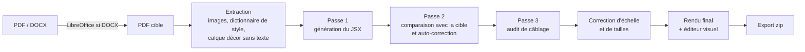

<div align="center">

# CV Smart · Design-to-Code

**Transforme le design d'un CV (PDF ou DOCX) en composant React prêt à brancher, ou en template Jinja prêt à remplir.**


</div>

---

Chaque cabinet de conseil a son propre gabarit de dossier de compétences. Reproduire ce gabarit à la main en React, avec
la pagination, les marges, les puces, les images de fond, prend des heures. **CV Smart Design-to-Code** automatise ce travail :
on dépose le gabarit, un modèle de langage multimodal le reconstruit, se compare à la cible pixel par pixel, puis s'auto-corrige.

Le résultat est un composant `<Nom>TemplateHtml({ cvData, assets })` qui réutilise le moteur de pagination du produit
(`PaginatedEntryPages`, `splitEntryIntoFragments`) et un export zip au format attendu par l'application cible.

## Fonctionnalités

- **PDF → React** : extraction du PDF, génération du JSX en plusieurs passes, auto-correction visuelle, correction d'échelle et de tailles.
- **DOCX → Jinja** : un template Word est balisé pour `docxtpl` (variables, boucles, conditions) à partir d'un CV exemple, avec la configuration et les prompts d'extraction associés.
- **Conversion DOCX → PDF automatique** : un `.docx` déposé dans l'interface est converti en PDF (LibreOffice) avant d'entrer dans la pipeline.
- **Pagination réelle** : le composant généré passe par le même moteur de pagination que la production, il déborde donc proprement sur plusieurs pages.
- **Éditeur visuel** : déplacer, redimensionner, retoucher les images et les textes directement sur le rendu.
- **Édition en langage naturel** : un panneau de chat applique une modification précise au JSX sans régénérer le template.
- **Suivi des coûts** : tokens et coût estimé de chaque passe, avec le cache de prompt pris en compte.
- **Annulation** : un run peut être arrêté à tout moment, y compris en plein appel au modèle.
- **Export** : archive zip avec le composant, le CSS Tailwind compilé et scopé, et les images.

## Comment ça marche



Le modèle ne devine rien « à l'œil » : il reçoit l'image cible, un **dictionnaire de style** extrait du PDF (position,
taille et couleur exactes de chaque texte), un **calque décor** sans texte pour découper les éléments graphiques, et une
**référence de template** déjà intégrée en production.

## Installation

### Prérequis

| Outil | Rôle |
| --- | --- |
| Python 3.12+ | backend FastAPI et scripts d'extraction |
| Node.js 20+ | frontend Vite, esbuild et Tailwind (compilation des templates) |
| Poppler (`pdftoppm`, `pdftohtml`, `pdfinfo`) | rasterisation et extraction du PDF |
| LibreOffice (`soffice`) | conversion DOCX → PDF et prévisualisation Jinja |
| Chromium via Playwright | captures du rendu |

Sur macOS :

```bash
brew install poppler
brew install --cask libreoffice
```

### Dépendances

```bash
# Backend
python3 -m venv venv
source venv/bin/activate
pip install fastapi "uvicorn[standard]" python-multipart python-dotenv \
            openai anthropic docxtpl python-docx pikepdf pillow numpy lxml playwright
playwright install chromium

# Outils Node de la pipeline (esbuild, tailwind, pixelmatch)
cd pipeline && npm install && cd ..

# Frontend
cd frontend && npm install && cd ..
```

## Configuration

Copier `pipeline/.env.example` vers `backend/.env` et renseigner la clé du fournisseur :

```env
MOONSHOT_API_KEY=...        # Kimi K3.1 Pro (modèle par défaut)
ANTHROPIC_API_KEY=...       # uniquement si MODEL pointe sur un modèle Claude
```

Le modèle se change dans une seule constante, `MODEL`, de `backend/cvsmart/pipeline/services/model_client_service.py`.
La table `PRICING` du même fichier sert à estimer le coût de chaque passe.

Variable optionnelle : `SOFFICE_PATH`, si `soffice` n'est pas trouvé automatiquement.

## Lancer le projet

```bash
# Terminal 1 : backend (port 8100)
cd backend
../venv/bin/uvicorn cvsmart.main:app --port 8100

# Terminal 2 : frontend (port 5173, proxy vers le backend)
cd frontend
npm run dev
```

Ouvrir <http://localhost:5173>, déposer un PDF ou un DOCX, choisir l'effort de raisonnement, lancer la génération.

